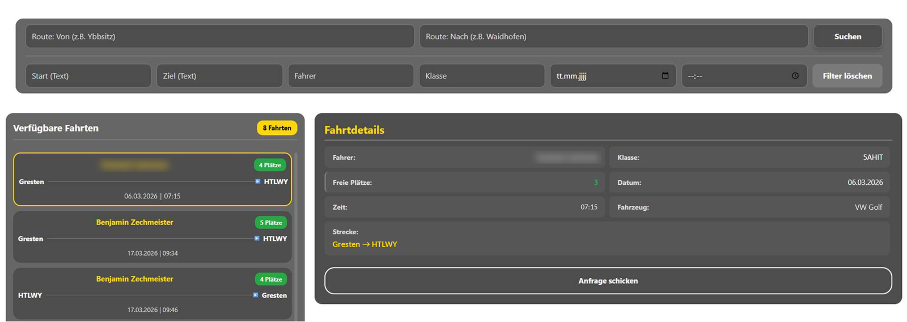
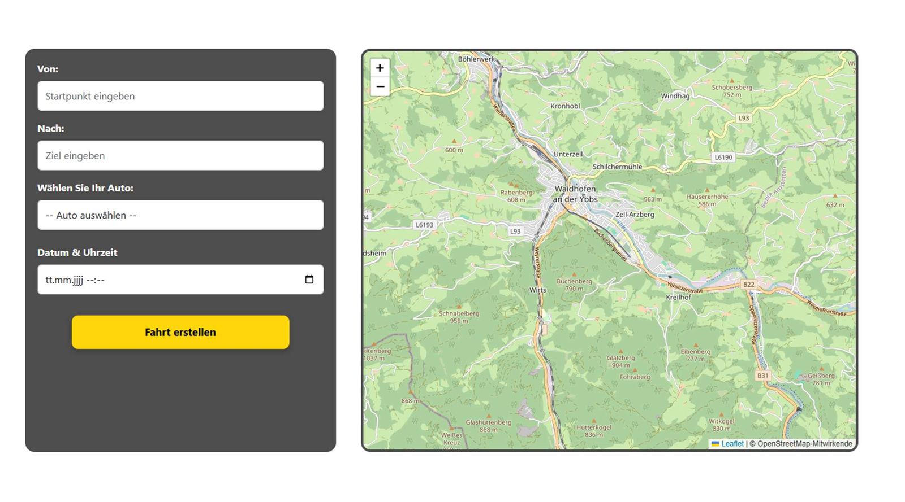
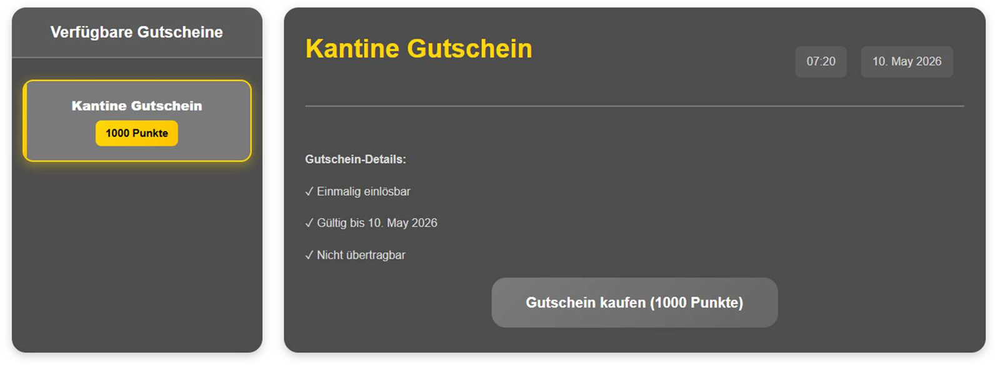

# Mitfahrbörse

Eine Webapp für Fahrgemeinschaften an der HTL Waidhofen/Ybbs. Wer mit dem Auto in die Schule fährt, stellt seine Fahrt ein, andere können mitfahren. Für jede Fahrt gibt es Punkte, die man im Shop gegen Gutscheine eintauschen kann, zum Beispiel für die Kantine.

Das Projekt ist unsere Diplomarbeit aus dem Schuljahr 2025/26, gebaut zu dritt.

## Screenshots

**Mitfahren:** Fahrten suchen, filtern und anfragen



**Fahrt erstellen**



**Shop:** Punkte einlösen



## Was die App kann

- Login mit dem Schulkonto über Microsoft Entra ID
- Fahrten anbieten, suchen, filtern und anfragen
- Auch Fahrten finden, die nur in der Nähe vorbeikommen, solange der Umweg für den Fahrer unter 30 km bleibt
- Benachrichtigungen in Echtzeit über SignalR
- Punkte für jede Fahrt und ein Shop zum Einlösen
- Adminbereich, unter anderem zum Anlegen von Gutscheinen

## Technik

ASP.NET Core MVC (.NET 9), Entity Framework Core mit SQL Server, SignalR, Microsoft Identity Web und Docker Compose.

## Team und Aufgabenverteilung

- **Benjamin Zechmeister** ([@ZechmeisterBenjamin](https://github.com/ZechmeisterBenjamin))
  - Datenbankdesign (ER-Modell) und Entity Framework Core (database-first)
  - Fahrten und Fahrzeuge anlegen, Zwischenstopps
  - Routen-Matching (`RouteMatchService`)
  - Filter auf der Mitfahren-Seite, Profileinstellungen
  - Punktesystem (`PointService`) mit zeitgesteuertem Hintergrundjob
  - Echtzeit-Benachrichtigungen mit SignalR (`NotificationHub`)
- **Daniel Daurer** ([@DaurerDaniel](https://github.com/DaurerDaniel))
  - Anmeldung über Microsoft Entra ID und Microsoft Graph
  - Anfragen, Fahrtenübersicht und Kalendereinträge
  - Shop mit Gutscheinen und QR-Codes, Admin-Funktionen
  - Docker-Setup
- **Daniel Macek** ([@Macek-Daniel](https://github.com/Macek-Daniel))
  - Frontend und Responsive Design, Dark Mode
  - Kartenintegration mit Leaflet und Routenanzeige
  - UI für Shop, Profil, Anfragen und Admin-Bereich

## Lokal starten

Mit Docker:

```bash
cd Mitfahrboerse
cp .env.example .env    # Werte eintragen
docker compose up --build
```

Die App läuft dann auf http://localhost:8080.

Ohne Docker kommen die Werte aus den User Secrets:

```bash
cd Mitfahrboerse
dotnet user-secrets set "ConnectionStrings:DefaultConnection" "<connection string>"
dotnet user-secrets set "AzureAd:TenantId" "<tenant-id>"
dotnet user-secrets set "AzureAd:ClientId" "<client-id>"
dotnet user-secrets set "AzureAd:ClientSecret" "<client-secret>"
dotnet user-secrets set "PointsApi:ApiKey" "<api-key>"
dotnet run
```

Für den Login braucht man eine eigene App-Registrierung in Microsoft Entra ID.
